<div align="center">



<br />

[](https://adamn.in)
[](https://adamn.in/resume.pdf)
[](https://www.linkedin.com/in/adam-mechaeil-763294194/)
[](https://x.com/10adamn)
[](https://www.youtube.com/@10adamn)
[](mailto:simplycleverdev@gmail.com)


</div>

## `about.md`

I design, build and ship full stack web platforms, from the database to the deploy pipeline. I also teach, which keeps my fundamentals sharp and my explanations short.

```yaml
role:      Full Stack Engineer
focus:     Production-grade web platforms (LMS, multi-tenant SaaS, real-time systems)
strengths: [System design, RBAC / auth, Automation, Performance tuning]
taught:    500+ students
shipped:   10+ projects across 2 companies, plus my own
based_in:  India
status:    Open to new work
```

<div align="center"></div>

## `open_to`

| | |
| :--- | :--- |
| **Full-time roles** | Full stack / product engineering, remote or on-site |
| **Opportunities overseas** | Relocation is on the table |
| **Freelance projects** | End-to-end builds: scoping, architecture, delivery |
| **Training** | Workshops and mentoring in modern JavaScript and full stack |

Reach me at [simplycleverdev@gmail.com](mailto:simplycleverdev@gmail.com) or on [LinkedIn](https://www.linkedin.com/in/adam-mechaeil-763294194/).

<div align="center"></div>

## `experience.log`

| When | Role | Highlights |
| :--- | :--- | :--- |
| **Dec 2023 – Jan 2026** | Full Stack Developer & Trainer, **Techstack** (Delhi) | Built an LMS for 200+ students with JWT-based RBAC and atomic ID generation. Automated Google Meet scheduling and attendance, saving the ops team 10+ hours a week. |
| **Nov 2022 – Aug 2023** | JavaScript Developer, **Proses Web Technologies** (Vadodara) | Optimized legacy React and Express apps: Lighthouse score up to 92, load time under 2 seconds. Fixed payment gateway bugs and shipped a responsive Tailwind UI. |

### Own work

- **[Modern Sensei](https://github.com/AdamMechaeil/lms)**: multi-tenant LMS for institutes of any scale (branches, admissions, students, batches, CRM). [Live demo](https://lms-client-jry7.onrender.com)
- **[Tharoorify](https://github.com/AdamMechaeil/Tharoorfiy)**: serverless Chrome extension, an on-demand dictionary and vocabulary logger.

<div align="center"></div>

## `stack.json`

| | |
| :--- | :--- |
| **Frontend** |      |
| **Backend** |      |
| **Data** |   |
| **Cloud & tools** |    |

<div align="center"></div>

## `now.txt`

- Growing Modern Sensei
- Making content on code, learning and self-improvement
- Off the clock: FC Barcelona and anime

<div align="center">


<br /><br />


</div>
