<div align="center">

<picture>
  <source media="(prefers-color-scheme: dark)" srcset="assets/banner-dark.svg" />
  <source media="(prefers-color-scheme: light)" srcset="assets/banner-light.svg" />
  
</picture>

<br />

[](https://adamn.in)
[](https://adamn.in/resume.pdf)
[](https://www.linkedin.com/in/adam-mechaeil-763294194/)
[](https://x.com/10adamn)
[](https://www.youtube.com/@10adamn)
[](mailto:simplycleverdev@gmail.com)

</div>

<br />

<picture>
  <source media="(prefers-color-scheme: dark)" srcset="assets/bar-about-dark.svg" />
  <source media="(prefers-color-scheme: light)" srcset="assets/bar-about-light.svg" />
  
</picture>

I design, build and ship full stack web platforms, from the database to the deploy pipeline. I also teach, which keeps my fundamentals sharp and my explanations short.

```yaml
role:      Full Stack Engineer
focus:     Production-grade web platforms (LMS, multi-tenant SaaS)
strengths: [System design, RBAC / auth, Automation, Performance tuning]
taught:    500+ students
shipped:   10+ projects, 2 companies, plus my own
status:    Open to new work
```

<br />

<picture>
  <source media="(prefers-color-scheme: dark)" srcset="assets/bar-open-dark.svg" />
  <source media="(prefers-color-scheme: light)" srcset="assets/bar-open-light.svg" />
  
</picture>

| Open to | Details |
| :--- | :--- |
| **Full-time roles** | Full stack / product engineering, remote or on-site |
| **Opportunities overseas** | Relocation is on the table |
| **Freelance projects** | End-to-end builds: scoping, architecture, delivery |
| **Training** | Workshops and mentoring in modern JavaScript and full stack |

Reach me at [simplycleverdev@gmail.com](mailto:simplycleverdev@gmail.com) or on [LinkedIn](https://www.linkedin.com/in/adam-mechaeil-763294194/).

<br />

<picture>
  <source media="(prefers-color-scheme: dark)" srcset="assets/bar-exp-dark.svg" />
  <source media="(prefers-color-scheme: light)" srcset="assets/bar-exp-light.svg" />
  
</picture>

| When | Role | Highlights |
| :--- | :--- | :--- |
| **Dec 2023 – Jan 2026** | Full Stack Developer & Trainer, **Techstack** (Delhi) | Built an LMS for 200+ students with JWT-based RBAC and atomic ID generation. Automated Google Meet scheduling and attendance, saving the ops team 10+ hours a week. |
| **Nov 2022 – Aug 2023** | JavaScript Developer, **Proses Web Technologies** (Vadodara) | Optimized legacy React and Express apps: Lighthouse score up to 92, load time under 2 seconds. Fixed payment gateway bugs and shipped a responsive Tailwind UI. |

<br />

<picture>
  <source media="(prefers-color-scheme: dark)" srcset="assets/bar-own-dark.svg" />
  <source media="(prefers-color-scheme: light)" srcset="assets/bar-own-light.svg" />
  
</picture>

| Project | What it is | Built with | Links |
| :--- | :--- | :--- | :--- |
| **modern-sensei** `[solo]` | Multi-tenant LMS for institutes of any scale: branches, admissions, students, batches and CRM in one platform. | `Next.js` `React` `Node.js` `Express` `MongoDB` `Tailwind` | `[live]` [demo](https://lms-client-jry7.onrender.com) · `[src]` [github](https://github.com/AdamMechaeil/lms) |
| **tharoorify** `[solo]` | Serverless Chrome extension: an on-demand dictionary and personal vocabulary logger. | `React` `Vite` `TypeScript` `OAuth` `Chrome API` | `[src]` [github](https://github.com/AdamMechaeil/Tharoorfiy) |
| **next-drop** | More coming. | `...` | stay tuned |

<br />

<picture>
  <source media="(prefers-color-scheme: dark)" srcset="assets/bar-stack-dark.svg" />
  <source media="(prefers-color-scheme: light)" srcset="assets/bar-stack-light.svg" />
  
</picture>

| Layer | Tools |
| :--- | :--- |
| **Frontend** |      |
| **Backend** |      |
| **Data** |   |
| **Cloud & tools** |    |

<br />

<picture>
  <source media="(prefers-color-scheme: dark)" srcset="assets/bar-now-dark.svg" />
  <source media="(prefers-color-scheme: light)" srcset="assets/bar-now-light.svg" />
  
</picture>

- Scavenging ideas
- Making content on code, learning, self-improvement and maybe random
- Off the clock: FC Barcelona, anime and hiphop

<br />

<div align="center">

<picture>
  <source media="(prefers-color-scheme: dark)" srcset="https://github-readme-stats.shion.dev/api?username=AdamMechaeil&include_all_commits=true&count_private=true&title_color=C9A24B&text_color=C3C8CE&icon_color=6A9A78&bg_color=0E1210&border_color=3E6B4F" />
  <source media="(prefers-color-scheme: light)" srcset="https://github-readme-stats.shion.dev/api?username=AdamMechaeil&include_all_commits=true&count_private=true&title_color=9A7420&text_color=1F2A23&icon_color=2F5D44&bg_color=F4F6F2&border_color=2F5D44" />
  
</picture>

<br /><br />


</div>

<br />

<picture>
  <source media="(prefers-color-scheme: dark)" srcset="assets/footer-dark.svg" />
  <source media="(prefers-color-scheme: light)" srcset="assets/footer-light.svg" />
  
</picture>
